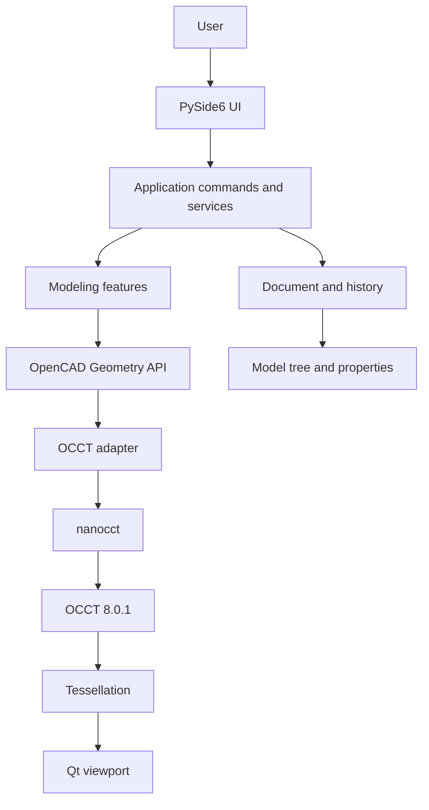

# OpenCAD architecture

## Dependency rules
1. UI never imports nanocct.
2. Document stores exact OCCT B-Reps and disposable display meshes.
3. Modeling features call the application-owned Geometry API.
4. Only the geometry adapter imports nanocct.
5. Viewport rendering is independent of B-Rep ownership and can be replaced.
6. Document changes go through reversible commands.

## Renderer
The first nanocct build binds Visualization classes but does not include TKOpenGl. The bootstrap viewport therefore uses Qt painting over OCCT tessellations. It is not the final high-performance renderer.
